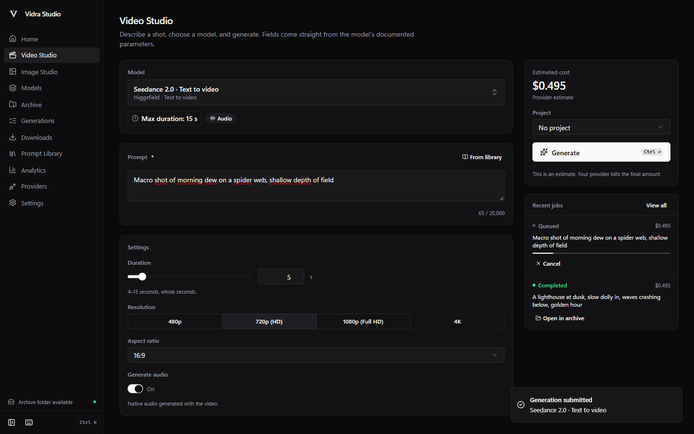

<p align="center">
  
</p>

<h1 align="center">Vidra Studio</h1>

<p align="center">
  <b>Open-source AI video & image studio for Windows.</b><br>
  Multiple providers, one workspace. Bring your own API keys; create, archive and own your work locally.
</p>

<p align="center">
  <a href="https://github.com/tolga-ileri/vidra-studio/actions/workflows/ci.yml"></a>
  <a href="https://github.com/tolga-ileri/vidra-studio/releases"></a>
  <a href="LICENSE"></a>
  
  <a href="https://github.com/tolga-ileri/vidra-studio/issues"></a>
</p>

<p align="center"><a href="README.tr.md">Türkçe</a></p>



**▶ [Watch the 65-second demo](docs/assets/demo/vidra-studio-demo.mp4)**: onboarding,
connecting a provider, generating, cost confirmation, the local archive and
playback, the Prompt Library, analytics, and switching to Turkish. It was
recorded from the real app against a local mock provider, so the media is
generated test footage and no paid calls were made.

> Vidra Studio is an independent open-source AI creation application. It is
> not affiliated with, endorsed by, or sponsored by the supported API
> providers.

## Download

Get the Windows installer from **[GitHub Releases](https://github.com/tolga-ileri/vidra-studio/releases)**.

- `Vidra.Studio_<version>_x64-setup.exe` is the recommended installer. It
  installs per user and does not need administrator rights.
- `SHA256SUMS.txt` contains the checksums. Verify them with
  `Get-FileHash <file> -Algorithm SHA256`.

The v0.1 installers are **not code-signed**, so Windows SmartScreen may warn
you. Choose *More info → Run anyway* only after checking the SHA-256 checksum.

**Requirements:** Windows 10 or 11 (x64) and Microsoft Edge WebView2, which
comes with Windows 11 and is installed automatically when missing. No Docker,
Node.js, database or command line is needed.

## Features

- **Video Studio and Image Studio.** Text-to-video, image-to-video,
  reference-to-video, video editing and extension, text-to-image and image
  editing, wherever the provider supports them.
- **Model-specific controls.** Every form is generated from a verified model
  manifest. You see each model's real duration range (up to 30 s where
  documented), resolutions, aspect ratios, audio, references and output
  counts. Invalid combinations are explained, never silently changed.
- **Transparent pricing.**
  - Provider estimate APIs are used where they exist.
  - Otherwise Vidra uses published rates, with the source and verification
    date.
  - Credits are shown as credits and never converted to money.
  - If a price can't be verified, Vidra shows **"Pricing unavailable"** and
    requires your explicit acknowledgement before submitting.
- **Permanent local archive.**
  - Finished outputs are downloaded, integrity-checked (SHA-256) and saved as
    real files. They play offline and survive restarts.
  - Downloads resume after network drops or app restarts.
  - Archive management: search, projects, favorites, tags, rename, export,
    regenerate, trash/restore, permanent delete, duplicate detection and
    backup/restore.
- **Your storage, your choice.** Pick any folder or drive, including external
  and network drives (with a warning).
  - Moving the archive copies and verifies every file first. Old copies are
    removed only if you confirm.
  - If a drive is unplugged, downloads pause until you reconnect.
- **Prompt Library.** Original templates with `{variables}`, categories,
  tags, favorites, version history, model presets and import/export.
- **Analytics.** Generations, success rate, output duration, and spending by
  provider and model. Estimated and confirmed amounts are kept separate,
  budget limits apply, and you can export to CSV.
- **Model catalog updates.** A signed (Ed25519), versioned model registry
  delivers verified model data. Models this app version can't run safely are
  shown as *Update required*.
- **English and Turkish** throughout.

## Supported providers (v0.1)

| Provider | Video | Image | Cancel | Cost estimate | Status |
| --- | --- | --- | --- | --- | --- |
| Higgsfield | ✓ (26 endpoints incl. image) | ✓ | queued jobs | provider estimate API | integrated, **mock-tested** |
| Replicate | ✓ | ✓ | ✓ | published rates | integrated, **mock-tested** |
| Kling AI | ✓ | ✓ | – (no API) | published unit tables (credits) | integrated, **mock-tested** |
| fal.ai | – | – | – | – | **excluded pending provider authorization** |

44 models in total. Their capabilities are documented in
[docs/MODEL_CAPABILITY_AUDIT.md](docs/MODEL_CAPABILITY_AUDIT.md).

> **Honesty note:** every integration is implemented from the providers'
> official documentation and tested against local mock servers that follow
> that documentation. **No integration has been tested against the live
> provider APIs yet** (no paid calls were made). Please report any mismatch.

## Getting started

1. Install and open Vidra Studio. Onboarding asks for your language and where
   to save media.
2. In **Providers**, add your own API key. It is stored in the **Windows
   Credential Manager**, never in files.
3. Open **Video Studio** or **Image Studio**, pick a model, and write a prompt
   (or use one from the **Prompt Library**).
4. Check the estimate and confirm. Vidra tracks the job, downloads the result
   and saves it to the **Archive**.

| | |
| --- | --- |
|  |  |
|  |  |

The screenshots show a demo profile running against a local mock provider.
The media is generated test footage, not AI output.

## Media kit

English launch assets (poster, GitHub social preview, LinkedIn/X banner,
Instagram story and promo video) built from real app captures are in
[media/promo](media/promo/README.md).

## Security and privacy

- API keys are stored in the Windows Credential Manager and read only by
  native Rust code.
  - They never reach the UI layer.
  - They are never written to logs, the database, backups or exports.
- **No Vidra server.** Requests go directly from your PC to the provider.
  There's no telemetry, analytics or crash reporting.
- Requests are built natively from bundled manifests. The UI can't send
  arbitrary URLs or file paths to the native side.
- Downloads are SSRF-protected (https, public hosts only, re-validated
  redirects), size-capped, type-checked and hashed, then written atomically.
- Strict CSP and minimal Tauri permissions; no shell access from the UI.

See [SECURITY.md](SECURITY.md), [PRIVACY.md](PRIVACY.md) and
[RELEASE_READINESS_REPORT.md](RELEASE_READINESS_REPORT.md).

## Architecture

```
apps/desktop/src          React + TypeScript UI (no secrets, no filesystem, no provider network access)
apps/desktop/src-tauri    Rust: credentials, provider adapters, jobs, downloads, archive, SQLite, backup, registry
packages/core             Shared TypeScript: manifest schema, rules, pricing, analytics, prompt templates
packages/core/manifests   Verified model manifests (Higgsfield, Replicate, Kling)
registry/v1               Signed model registry (Ed25519)
```

Details: [docs/architecture.md](docs/architecture.md).

## Development

You need Node.js 22+, pnpm, Rust (stable, MSVC) and WebView2.

```bash
pnpm install
pnpm dev                # desktop app with hot reload
pnpm check              # typecheck, lint, unit tests, Rust tests
```

The native end-to-end tests drive the real app against a local mock provider:

```bash
pnpm --filter @vidra/desktop tauri build --debug --no-bundle --features e2e-mock
pnpm --filter @vidra/desktop exec playwright test -c playwright.native.config.ts
```

## Roadmap

- Live verification of each provider with maintainers' own keys
- fal.ai, once written authorization exists
- Runway, Luma and Google Veo, where official API access and terms allow
- Code-signed installers

## Contributing

See [CONTRIBUTING.md](CONTRIBUTING.md) and the
[Code of Conduct](CODE_OF_CONDUCT.md). Security reports go through
[SECURITY.md](SECURITY.md).

## License

Released under the [MIT License](LICENSE). Third-party components are listed
in [THIRD_PARTY_LICENSES.md](THIRD_PARTY_LICENSES.md). Provider names are
trademarks of their owners and appear only to describe compatibility (see
[NOTICE.md](NOTICE.md) and [PROVIDER_TERMS_REVIEW.md](PROVIDER_TERMS_REVIEW.md)).

---

Built by **Tolga İleri** · [github.com/tolga-ileri](https://github.com/tolga-ileri)
