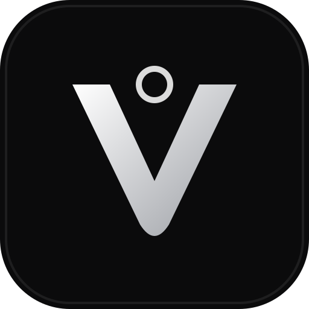
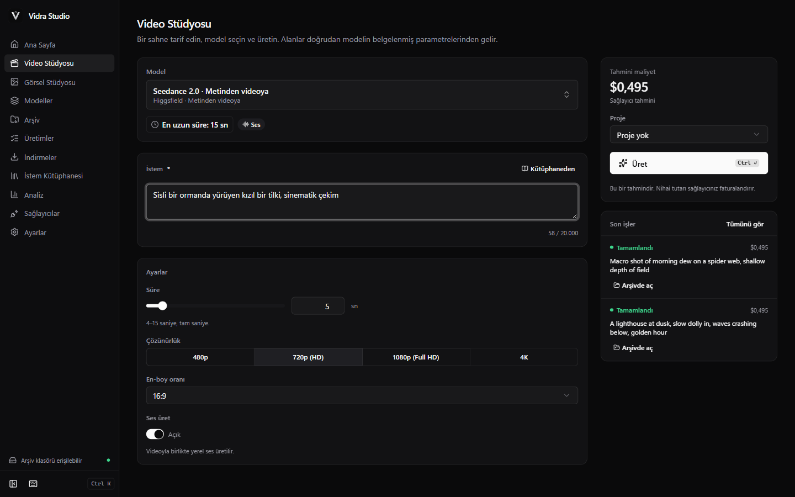
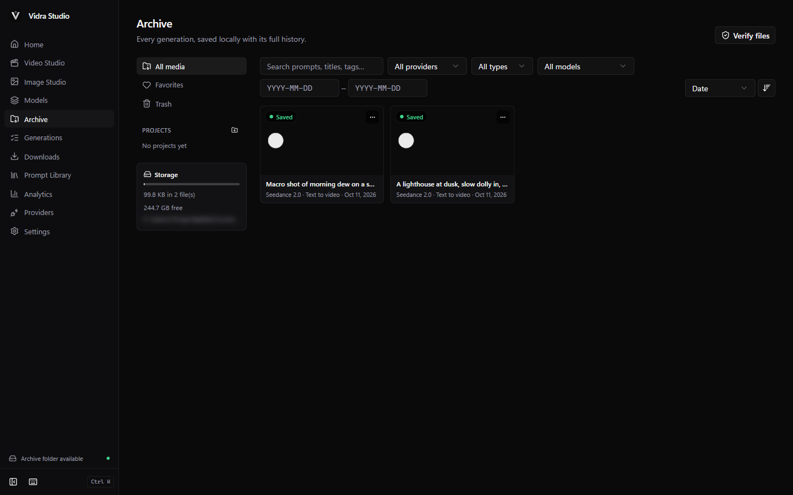
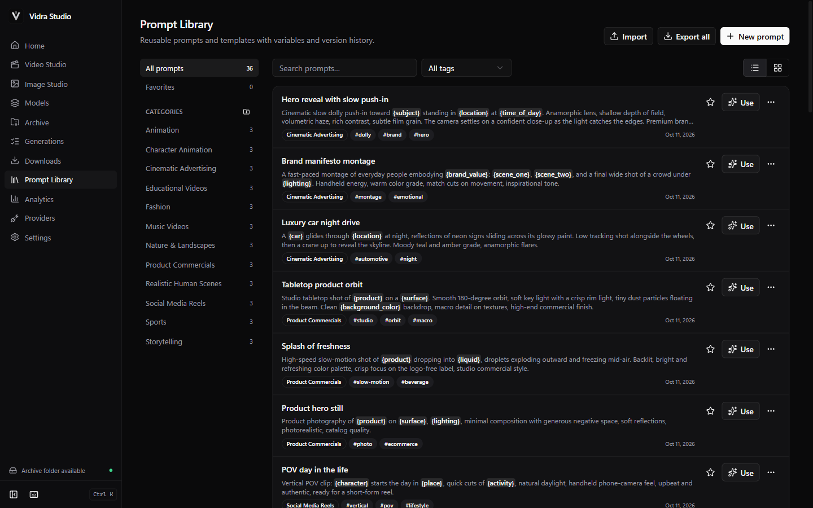
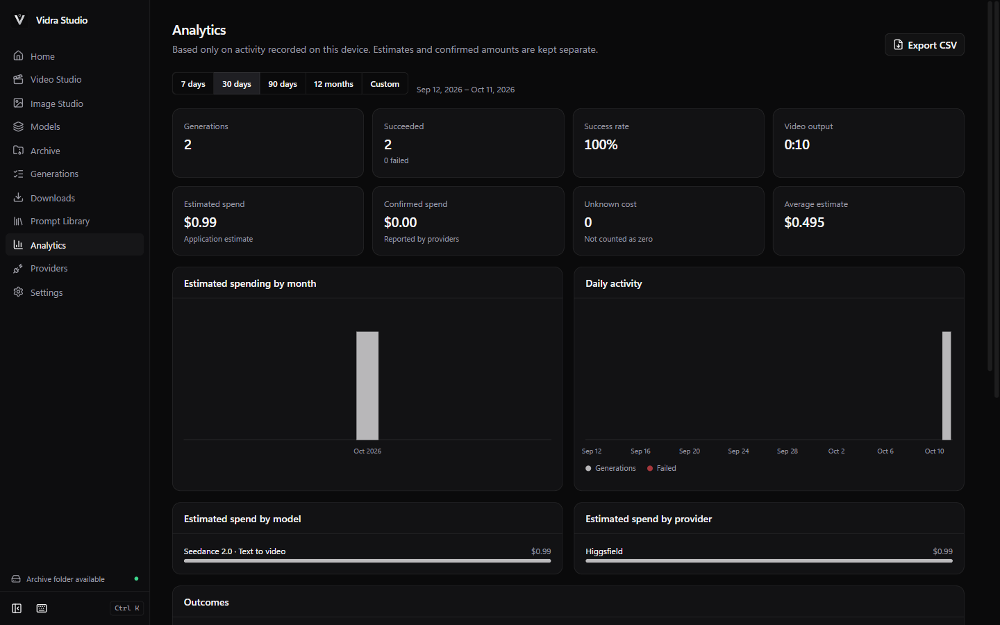
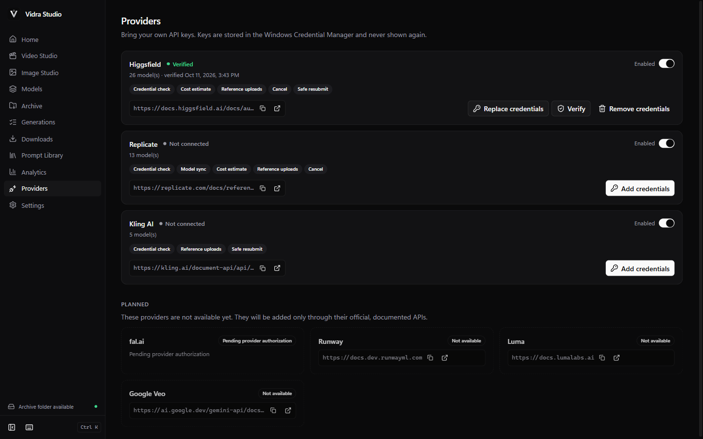

<p align="center">
  
</p>

<h1 align="center">Vidra Studio</h1>

<p align="center">
  <b>Windows için açık kaynaklı yapay zekâ video ve görsel stüdyosu.</b><br>
  Birden fazla sağlayıcı, tek çalışma alanı. Kendi API anahtarlarını kullan; üret, arşivle, işine sahip ol.
</p>

<p align="center">
  <a href="https://github.com/tolga-ileri/vidra-studio/actions/workflows/ci.yml"></a>
  <a href="https://github.com/tolga-ileri/vidra-studio/releases"></a>
  <a href="LICENSE"></a>
  
</p>

<p align="center"><a href="README.md">English</a></p>



**▶ [65 saniyelik tanıtım videosunu izle](docs/assets/demo/vidra-studio-demo.mp4)**:
ilk kurulum, sağlayıcı bağlama, üretim, maliyet onayı, yerel arşiv ve
oynatma, İstem Kütüphanesi, analiz ve Türkçeye geçiş. Video gerçek
uygulamadan, yerel bir sahte (mock) sağlayıcıya karşı kaydedildi. Görüntüler
test amaçlı üretilmiş içeriktir ve ücretli çağrı yapılmadı.

> Vidra Studio bağımsız, açık kaynaklı bir yapay zekâ üretim uygulamasıdır.
> Desteklenen API sağlayıcılarıyla bağlantılı değildir; bu sağlayıcılar
> tarafından onaylanmamış veya desteklenmemektedir.

## İndirme

Windows yükleyicisini **[GitHub Releases](https://github.com/tolga-ileri/vidra-studio/releases)** sayfasından indir.

- `Vidra.Studio_<sürüm>_x64-setup.exe` önerilen yükleyicidir. Kullanıcıya
  özel kurulur ve yönetici izni gerektirmez.
- `SHA256SUMS.txt` sağlama değerlerini içerir. Doğrulamak için:
  `Get-FileHash <dosya> -Algorithm SHA256`

v0.1 yükleyicileri **kod imzalı değildir**, bu yüzden Windows SmartScreen
uyarı gösterebilir. SHA-256 değerini doğruladıktan sonra *Daha fazla bilgi →
Yine de çalıştır* seçeneğini kullan.

**Gereksinimler:** Windows 10 veya 11 (x64) ve Microsoft Edge WebView2.
WebView2 Windows 11'de hazır gelir, eksikse otomatik kurulur. Docker,
Node.js, veritabanı veya komut satırı gerekmez.

## Özellikler

- **Video ve Görsel Stüdyosu.** Sağlayıcının desteklediği yerlerde metinden
  videoya, görselden videoya, referanstan videoya, video düzenleme ve
  uzatma, metinden görsele ve görsel düzenleme.
- **Modele özel ayarlar.** Her form doğrulanmış model tanımından oluşturulur.
  Her modelin gerçek süre aralığını (belgelendiği yerde 30 saniyeye kadar),
  çözünürlüklerini, en-boy oranlarını, ses, referans ve çıktı sayısı
  seçeneklerini görürsün. Geçersiz kombinasyonlar açıklanır, sessizce
  değiştirilmez.
- **Şeffaf fiyatlandırma.**
  - Sağlayıcının tahmin API'si varsa o kullanılır.
  - Yoksa kaynağı ve doğrulama tarihiyle yayımlanan fiyat kullanılır.
  - Krediler paraya çevrilmez.
  - Fiyat doğrulanamıyorsa **"Fiyat doğrulanamadı"** gösterilir ve
    göndermeden önce açık onayın istenir.
- **Kalıcı yerel arşiv.**
  - Tamamlanan çıktılar indirilir, SHA-256 ile doğrulanır ve gerçek dosya
    olarak kaydedilir. Çevrimdışı oynatılır ve yeniden başlatmalardan
    etkilenmez.
  - Ağ kesintisi veya uygulama yeniden başlatıldığında indirmeler kaldığı
    yerden devam eder.
  - Arşiv yönetimi: arama, projeler, favoriler, etiketler, yeniden
    adlandırma, dışa aktarma, yeniden üretme, çöp kutusu/geri yükleme,
    kalıcı silme, kopya algılama ve yedekleme/geri yükleme.
- **Depolama senin kontrolünde.** Herhangi bir klasörü veya sürücüyü seçebilirsin;
  harici ve ağ sürücüleri de olur (ağ için uyarıyla).
  - Taşıma işleminde önce tüm dosyalar kopyalanıp doğrulanır. Eski kopyalar
    yalnızca onay verirsen silinir.
  - Sürücü çıkarılırsa indirmeler yeniden bağlanana kadar duraklar.
- **İstem Kütüphanesi.** `{değişken}` içeren özgün şablonlar, kategoriler,
  etiketler, favoriler, sürüm geçmişi, model ön ayarları ve içe/dışa
  aktarma.
- **Analiz.** Üretimler, başarı oranı, toplam süre, sağlayıcı ve modele göre
  harcama. Tahmini ve onaylanmış tutarlar ayrı tutulur, bütçe sınırları
  uygulanır ve CSV olarak dışa aktarabilirsin.
- **Model kataloğu güncellemeleri.** İmzalı (Ed25519), sürümlü model kaydı
  doğrulanmış model bilgilerini getirir. Bu sürümün güvenle çalıştıramadığı
  modeller *Güncelleme gerekli* olarak gösterilir.
- Baştan sona **Türkçe ve İngilizce**.

## Desteklenen sağlayıcılar (v0.1)

| Sağlayıcı | Video | Görsel | İptal | Maliyet tahmini | Durum |
| --- | --- | --- | --- | --- | --- |
| Higgsfield | ✓ | ✓ | sıradaki işler | sağlayıcı tahmin API'si | entegre, **mock ile test edildi** |
| Replicate | ✓ | ✓ | ✓ | yayımlanan fiyatlar | entegre, **mock ile test edildi** |
| Kling AI | ✓ | ✓ | – (API yok) | yayımlanan birim tabloları (kredi) | entegre, **mock ile test edildi** |
| fal.ai | – | – | – | – | **sağlayıcı izni beklendiği için dahil değil** |

Toplam 44 model var. Yetenekleri
[docs/MODEL_CAPABILITY_AUDIT.md](docs/MODEL_CAPABILITY_AUDIT.md) dosyasında
belgelenmiştir.

> **Dürüstlük notu:** Tüm entegrasyonlar sağlayıcıların resmî belgelerine
> göre yazıldı ve bu belgelere uyan yerel sahte (mock) sunuculara karşı test
> edildi. **Hiçbir entegrasyon henüz gerçek sağlayıcı API'sine karşı test
> edilmedi** (ücretli çağrı yapılmadı). Bir uyumsuzluk görürsen lütfen
> bildir.

## Ekran görüntüleri

| | |
| --- | --- |
|  |  |
|  |  |

Ekran görüntüleri yerel sahte sağlayıcıyla çalışan bir demo profilini
gösterir. Görüntüler yapay zekâ çıktısı değil, test amaçlı üretilmiş
içeriktir.

## Başlarken

1. Vidra Studio'yu kur ve aç. İlk kurulumda dil ve medyanın kaydedileceği
   yer sorulur.
2. **Sağlayıcılar** bölümüne kendi API anahtarını ekle. Anahtar dosyalarda
   değil, **Windows Kimlik Bilgisi Yöneticisi**'nde saklanır.
3. **Video Stüdyosu** veya **Görsel Stüdyosu**'nu aç, bir model seç ve istem
   yaz (ya da **İstem Kütüphanesi**'nden birini kullan).
4. Tahmini kontrol et ve onayla. Vidra işi takip eder, sonucu indirir ve
   **Arşiv**'e kaydeder.

## Güvenlik ve gizlilik

- API anahtarları Windows Kimlik Bilgisi Yöneticisi'nde saklanır ve
  yalnızca yerel Rust kodu tarafından okunur.
  - Arayüz katmanına hiç ulaşmaz.
  - Günlüklere, veritabanına, yedeklere veya dışa aktarımlara yazılmaz.
- **Vidra sunucusu yok.** İstekler bilgisayarından doğrudan sağlayıcıya
  gider. Telemetri, analiz veya çökme raporu yoktur.
- İndirmeler SSRF'ye karşı korunur (yalnızca https ve herkese açık
  sunucular, yönlendirmeler yeniden doğrulanır). Boyut sınırlıdır, tür
  kontrol edilir, özet değeri hesaplanır ve dosya atomik olarak yazılır.

Ayrıntılar için [SECURITY.md](SECURITY.md), [PRIVACY.md](PRIVACY.md) ve
[RELEASE_READINESS_REPORT.md](RELEASE_READINESS_REPORT.md) dosyalarına bak.

## Geliştirme

Node.js 22+, pnpm, Rust (stable, MSVC) ve WebView2 gerekir.

```bash
pnpm install
pnpm dev
pnpm check
```

## Lisans

[MIT Lisansı](LICENSE) ile yayımlanır. Üçüncü taraf bileşenler
[THIRD_PARTY_LICENSES.md](THIRD_PARTY_LICENSES.md) dosyasında listelenir.
Sağlayıcı adları sahiplerinin ticari markalarıdır ve yalnızca uyumluluğu
belirtmek için kullanılır (bkz. [NOTICE.md](NOTICE.md),
[PROVIDER_TERMS_REVIEW.md](PROVIDER_TERMS_REVIEW.md)).

---

**Tolga İleri** tarafından geliştirildi · [github.com/tolga-ileri](https://github.com/tolga-ileri)
